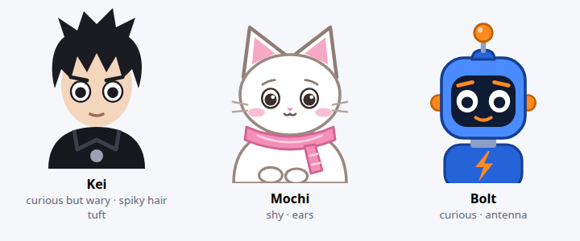

# agent-skills

[](https://skills.sh/hinorashi/agent-skills)

Reusable [Agent Skills](https://agentskills.io/specification) by @hinorashi.

Version is each skill's `metadata.version`; the link opens its changelog.

| Skill | Version | What it does |
|---|---|---|
| [changelog](skills/changelog/SKILL.md) | [1.0.0](skills/changelog/CHANGELOG.md) | Viết và đối chiếu ghi chú `[Unreleased]` từ thay đổi thực tế; gộp mục trùng, giữ lịch sử đã phát hành và không tự commit/tag/push. |
| [release](skills/release/SKILL.md) | [1.0.0](skills/release/CHANGELOG.md) | Phát hành có xác nhận trên GitHub/Gitea; ưu tiên quy trình của kho, kèm script độc lập và kiểm thử từ Ganttz cho kho phù hợp. |
| [peekaboo](skills/peekaboo/SKILL.md) | [1.5.0](skills/peekaboo/CHANGELOG.md) | Adds a peeking mascot to your web app: pick a ready-made character (Kei, Mochi, Bolt), describe a new one, or bring your own image (photo, pet, sketch) and it draws an original SVG in chibi or realistic style, checking the image is eligible first and showing a preview page for your approval before touching your code. The mascot peeks out from page edges without covering the UI, looks around, blinks, hides and leaves a clickable keepsake. One mascot per app: if one is already installed, it asks whether to replace it. |



## Install

```bash
npx skills add hinorashi/agent-skills --skill peekaboo
```

Replace `hinorashi/agent-skills` with the GitHub `owner/repo` this is pushed to. Skills appear on
[skills.sh](https://skills.sh) automatically once people install them with the `skills` CLI.

### Cài skill changelog và release

```bash
npx skills add hinorashi/agent-skills --skill changelog --skill release
```

Hai skill dùng độc lập được; cài cả hai để quy trình release gọi bước soạn ghi chú
khi cần. Bản trong checkout này chỉ sẵn sàng cài từ GitHub sau khi được đẩy lên remote.
Để cài ngay từ checkout, chạy trong dự án đích:

```bash
npx skills add /home/quannt71/project/agent-skills --skill changelog --skill release
```

Ví dụ yêu cầu: “Cập nhật changelog cho thay đổi hiện tại”, “Chỉ chuẩn bị release
1.2.0, chưa công bố”, hoặc “Phát hành 1.2.0 lên Gitea sau khi kiểm tra”.

**Changelog nên là skill, không phải hook tự viết.** Dùng skill khi cần tổng hợp
hoặc trước release; để agent ghi chú trong công việc hằng ngày, thêm chỉ dẫn thường
trực theo [hướng dẫn tích hợp](skills/changelog/references/integration.md) sau khi
được đồng ý. Chỉ dẫn không bảo đảm thực thi; nếu cần cưỡng chế, dùng CI kiểm tra
chính sách rõ ràng. Không tự động viết changelog sau mỗi lần sửa tệp/kết thúc phiên.
Không có hook hoặc chỉ dẫn thường trực nào được tự cài bởi hai skill này.

Skill release kèm [công cụ độc lập](skills/release/scripts/release.mjs) và
[hợp đồng sử dụng](skills/release/references/cli.md). Công cụ cần Node.js, Git, curl,
terminal tương tác và npm nếu có manifest; hỗ trợ một gói npm ở gốc hoặc kho chỉ
có changelog, không hỗ trợ workspaces. Không có `--dry-run`: xem trước/chuẩn bị chỉ
là quy trình của skill, không phải một lần chạy lệnh công bố. Script không publish
lên registry, tải artifact hoặc deploy.

### Install from a local checkout

From the root of this repository, install the skill into the current project with the `skills` CLI:

```bash
npx skills add /home/quannt71/project/agent-skills/skills/peekaboo --skill peekaboo
```

For a personal installation without the CLI, copy the skill folder into GitHub Copilot's local skills directory:

```bash
mkdir -p ~/.copilot/skills
cp -R /home/quannt71/project/agent-skills/skills/peekaboo ~/.copilot/skills/
```

## Estimated cost

These are rough figures for one run of `peekaboo` with GitHub Copilot. The Bolt figure comes from a real run in
another project. The others are scaled from how long the skill's test runs took, at about 16.5k tokens per credit.

| Task | Tokens | Copilot credits |
|---|---|---|
| Answer the interview only (e.g. a vague request) | ~10k | < 1 |
| Add a ready-made character (e.g. Bolt) | ~156k | ~9.5 |
| Draw a new character and add it to a small app | ~115–160k | ~7–10 |
| Mascot from your image, with one preview round | ~130–180k | ~8–11 |

Actual cost depends on the model and its credit multiplier, how large the app is, and how many follow-up tweaks you ask for.

## Validate

Kiểm thử công cụ release không cần cài dependency npm; test HTTPS cần openssl:

```bash
node --test skills/release/scripts/release.test.mjs
```

Các tình huống đánh giá hành vi agent nằm trong
[changelog/evals](skills/changelog/evals/evals.json) và
[release/evals](skills/release/evals/evals.json); đây không phải benchmark đã chạy.
Để kiểm tra cấu trúc hai skill bằng công cụ Agent Skills:

```bash
uvx --from "git+https://github.com/agentskills/agentskills#subdirectory=skills-ref" skills-ref validate skills/changelog
uvx --from "git+https://github.com/agentskills/agentskills#subdirectory=skills-ref" skills-ref validate skills/release
```

```bash
uvx --from "git+https://github.com/agentskills/agentskills#subdirectory=skills-ref" skills-ref validate skills/peekaboo
```

## Releasing a new peekaboo version

Installed apps keep their own copy of the mascot engine. When a change affects them, bump `metadata.version` in
[SKILL.md](skills/peekaboo/SKILL.md) and `PEEKABOO_VERSION` in
[peekaboo.ts](skills/peekaboo/assets/peekaboo.ts) to the same value, and add a changelog entry with the required app
changes to [updating.md](skills/peekaboo/references/updating.md). Move the `[Unreleased]` notes in
[CHANGELOG.md](skills/peekaboo/CHANGELOG.md) under the new version and update the version in the skill table above. The
next time someone uses the skill in an app with an older mascot, it offers to update it.
