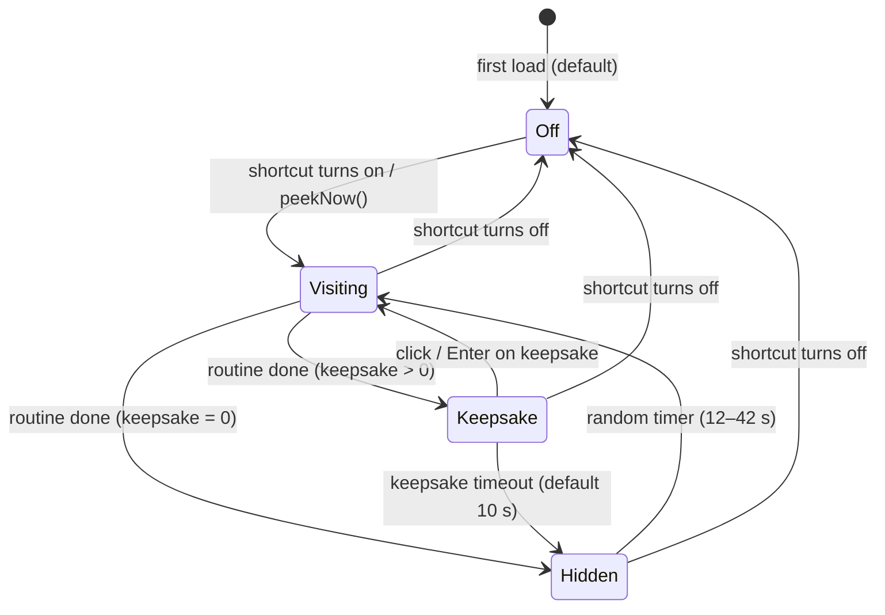

# Peekaboo behavior reference

What the mascot does, why, and which invariants an adaptation must keep. `assets/peekaboo.ts` implements all of this;
read this file when you need to change behavior, adapt to an unusual layout, or debug placement.

## Contents

1. Lifecycle
2. Placement model
3. Never covering the app
4. Keepsake (call-back mark)
5. On/off toggle and notices
6. Personality: tuning the routine
7. Accessibility and etiquette
8. Integration gotchas

## 1. Lifecycle

Default routine inside `visit()` (ms are waits before each step):

| Wait | Step |
|---|---|
| 0 | rise (`peeking`, 0.5 s springy transition) |
| 700 | look one way at random (`data-look`) |
| 800 | look the other way |
| 800 | look ahead |
| 250 | blink starts (`blinking`, 0.3 s scaleY on `.pb-eyes`) |
| 320 | blink ends |
| 450 | sink to keepsake position (or out of sight) |
| 500 | keepsake grab area appears, expiry timer starts |

Every await checks a run counter (`run`). Hiding or toggling bumps it, so an in-flight visit stops at its next step
instead of fighting the new state. Keep this pattern when adding steps.

Random visits are skipped while the mascot is off, a visit is running, the tab is hidden, the user prefers reduced
motion, or the page is in fullscreen.

## 2. Placement model

An **edge** is one side of an anchor element (`EdgeSpec { anchor, side, inward? }`). The mascot stands with its feet on
the edge and rises away from the anchor (outward) or into it (`inward: true`, e.g. rising up inside a header from its
bottom border).

| side | outward direction | inward direction |
|---|---|---|
| top | up | down |
| bottom | down | up |
| left | left | right |
| right | right | left |

A **spot** is `{ edge, along }`, the offset along that edge. The frame (`.peekaboo`) is a clipping window
`width × rise` (rotated for left/right) placed against the edge; the figure inside is rotated so "down" points at the
edge (`up 0°, down 180°, left -90°, right 90°`). Rise is the tallest value from `height` down to `minRise` (step 4 px)
that fits, so the feet stay behind the edge when room is short; spots below `minRise` are skipped because the face
would be cut off.

`randomSpot()` samples 12 offsets per edge, keeps those that fit and are fully in the viewport, picks an edge with at
least one valid spot at random, then a spot. Choosing the edge first keeps long edges from dominating.

All boxes use page coordinates (`getBoundingClientRect()` + scroll), so the frame scrolls with the content. If the
mascot is appended to a positioned `body`, `origin()` compensates.

## 3. Never covering the app

`fits(box)` rejects a window that:

- leaves the document (negative left/top or wider than `scrollWidth`), or
- overlaps any element matching `obstacles` – with zero gap for `touchable` (the surfaces it hides behind) and `gap`
  (8 px) for everything else.

Choose obstacles from what users read or click: panels, editors, previews, buttons, inputs, labels, links, selects,
text blocks, badges, `details`. Do not list the anchor of an inward edge (the mascot is inside it by design); list its
interactive children instead. When the layout changes (resize, panel resize), the keepsake is re-placed, or removed if
its spot no longer fits.

Stacking: the frame and grab area default to `z-index: 10`. Keep them below sticky headers, menus, dialogs and toasts.

## 4. Keepsake (call-back mark)

After the routine, the figure sinks by `rise - keepsake` px instead of fully, leaving the top `keepsake` px (default 14)
visible: hair tuft, ears, antenna, hat tip, leaf… That part carries class `pb-keepsake` and twitches every 2.4 s.

An invisible `<button class="peekaboo-mark">` (`75% width × keepsake + 2`, rotated like the figure) sits over it with
its base on the edge. Hover/focus tugs the keepsake up 6 px (`:has()` rule); click or Enter replays the visit at the same
spot and returns focus to the button. It disappears after `keepsakeMs` (default 10 s).

Make the duration configurable without code edits, e.g. Vite `VITE_<NAME>_KEEPSAKE_SECONDS=10` in a committed `.env`
(add `*.local` to `.gitignore` for overrides), parse it as a positive number, and warn in the console and fall back to
the default when invalid.

## 5. On/off toggle and notices

- Off by default; the first press of the shortcut turns it on and it peeks out immediately.
- The choice persists in `localStorage` (`peekaboo-<name>` → `on`/`off`); storage errors fall back silently.
- Shortcut matched by `event.code` (layout and macOS Option safe); ignore repeats, composition, and already-handled
  events. Pick a combination the app and browser do not use (Alt+first letter is a good start; check conflicts).
- Notify only when the user turns it on and no spot fits. Success needs no message; the mascot is the feedback.
  Route the notice through the app's own toast/notification system via `options.notify`.

## 6. Personality: tuning the routine

Personality lives in the `steps` array of `visit()`, the CSS transition curve, and the interval. Examples:

| Trait | Adjustments |
|---|---|
| Shy | shorter looks (400–500 ms), quick sink, longer interval, smaller `keepsake` |
| Curious | extra look pair, slight tilt (`rotate` on `.pb-face`), shorter interval |
| Sleepy | slow blink (0.6 s, two blinks), slower rise (`.8s ease-out`) |
| Cheeky | wink (blink one eye: wrap each eye in its own group), bouncier spring curve |
| Stoic | no head shift, only pupils move, single slow blink |

Keep the whole visit under ~5 s and keep the run-counter checks.

## 7. Accessibility and etiquette

- Decorative: the frame is `aria-hidden` and `pointer-events: none`; it never takes focus or blocks clicks.
- The keepsake button has an `aria-label` ("Call <name> back") and a visible focus ring.
- Honors `prefers-reduced-motion`: no random visits, no transitions or twitch.
- Off by default and silent on success: a mascot is a delight, not a nag.

## 8. Integration gotchas

- Containers with `overflow: hidden` or `contain: paint` do not matter: the mascot is appended to `body`.
- Sticky elements: an obstacle's box is measured at the moment of placement; sticky headers that move on scroll can end
  up over a keepsake. Keep the z-index below them, and re-place on scroll if needed.
- SPA route changes: call `destroy()` when the host view unmounts; create once per page, not per render.
- SSR: create it only in the browser (`onMount`, `useEffect`, `DOMContentLoaded`).
- Tests: see `testing.md` for fake clocks and a deterministic `random`.
